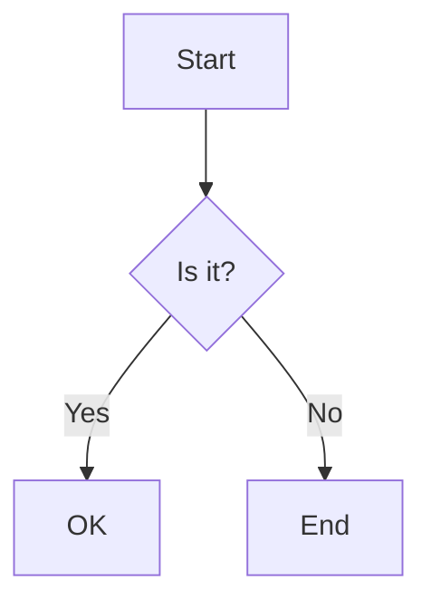

- [ ] unchecked
- [x] checked
- [X] uppercase checked
- [ ] item with **bold** and `code`
  - [ ] nested task
  - [x] nested done
1. [ ] ordered task
2. [x] ordered done
- [] not a task
- [ ]not a task (no space)


---

| Name | Value |
| ---- | ----- |
| a    | 1     |
| b    | 2     |


---




---

```math
\sum_{i=1}^{n} i = \frac{n(n+1)}{2}
```


---

Text with a footnote[^1] and a named one[^note].
Reference the first again[^1].

[^1]: First footnote.
[^note]: Named footnote with **bold**.


---

> [!NOTE]
> Useful information.

> [!TIP]
> Helpful advice.

> [!IMPORTANT]
> Key information.

> [!WARNING]
> Urgent info.

> [!CAUTION]
> Risks.


---

<details>
<summary>Click to expand</summary>

Hidden **markdown** content.

- list
```js
code();
```

</details>

<details open>
<summary>Open by default</summary>

Visible.

</details>
